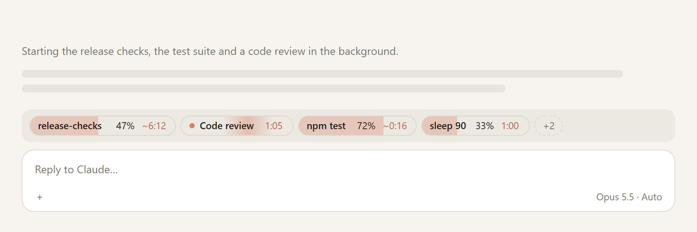
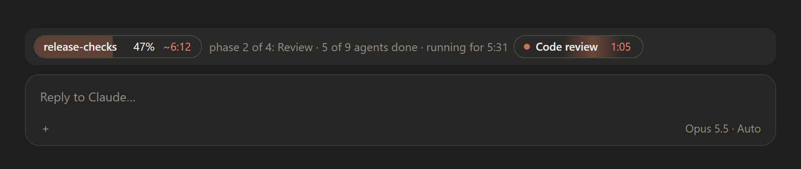
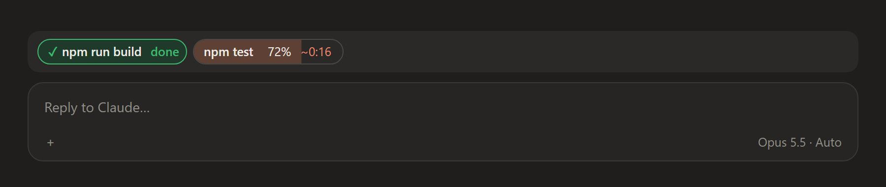

# Background Pills for Claude Code

See what Claude Code is doing in the background at a glance. **Background Pills** adds one quiet
row of pills above the Claude Code message box, one pill for each piece of background work. It
works only in Claude Code (the Code tab of the desktop app, and the terminal), not in regular
Claude app chats. Each pill fills up as
the work moves toward its end, with the percent and the time left. The row is there only while
something runs.

<picture>
  <source media="(prefers-color-scheme: dark)" srcset="docs/pills-dark.png">
  
</picture>

Live, the pills move: the fill grows, the countdown ticks every second, and work with no known
end shows a breathing dot and a passing light.


## What each pill shows

| Background work | The pill shows |
|---|---|
| **Workflow** (the Workflow tool) | Fill and percent from the phases passed and the agents done in the current phase, plus an estimated time left |
| **Background shell command** | An exact countdown when the command states its wait (`sleep 90`, `Start-Sleep -Seconds 90`, `timeout /t 90`); otherwise an estimate (`~`) from earlier runs of the same command; the first time, the time running |
| **Background agent** | A breathing dot and a passing light, and the time running |
| **Anything else in the background** | Its name and the time running |

**Point at a pill to see its detail** on the same row: a workflow's phase and agents, what an
agent is doing and its tokens, where a command's length comes from.



**When work ends well**, its pill turns green with a ✓ for two seconds, then goes.



Pills keep the order the work started in, so they never jump. Pills that do not fit the row are
counted in a last `+N`; point at it for their names. With the band collapsed, the status line
under the message box says the same in a few words, for example
`⏳ release-checks 47% ~6:12 · npm test 72% ~0:16`.

## Install

> **Background Pills is a Claude Code mod. It works only in Claude Code: in the Code tab of the
> Claude desktop app (graphic pills) and in the terminal (text pills). It does not appear in
> regular Claude app chats. After installing, start a new session in the Code tab.**

In Claude Code, run:

```
/plugin marketplace add MarcoDeliaBot/claude-code-background-pills
/plugin install background-pills@background-pills
```

The pictures above show the Code tab of the desktop app. In the terminal the pills are text, with
bars like `▰▰▰▱▱▱`. Built and tested on Claude Code 2.1.330.

## Turn it off

- **Code tab of the desktop app:** click **+** next to the message box, choose **Plugins**, and
  turn off `background-pills`.
- **Terminal:** `claude plugin disable background-pills@background-pills`
  (use `enable` to turn it back on, `uninstall` to remove it).

The change applies to sessions started after it.

## Where the numbers come from

- **Workflow percent:** the phases already passed plus the share of agents done in the current
  phase. It never goes back, and it stops at 99% until the run ends.
- **Workflow time left (`~`):** from earlier runs of the same workflow when there are any;
  otherwise from the pace so far, once 10% is done and 15 seconds have passed.
- **Command countdown:** exact when the command states how long it waits; an estimate (`~`) from
  the same command's earlier runs otherwise.
- **Over time:** when work runs past its expected length, the countdown becomes `+0:40`.
- **`≥` in front of a time:** the work was already running when the mod first saw it.

## Privacy

Background Pills only watches the work of your own session; it never changes what Claude does and
sends nothing anywhere. To give repeated commands and workflows a countdown, it keeps the last 5
run times of at most 80 commands or workflows in its own store inside your Claude Code
configuration folder.

## Develop

```
claude plugin validate background-pills
claude plugin test background-pills
```

The mod is one hooks module, [`background-pills/hooks/register.tsx`](background-pills/hooks/register.tsx),
with its tests next to it. The pictures in this README are drawn by the mod's own pill code; the
message box around them is a mock-up.

## License

[MIT](LICENSE)
